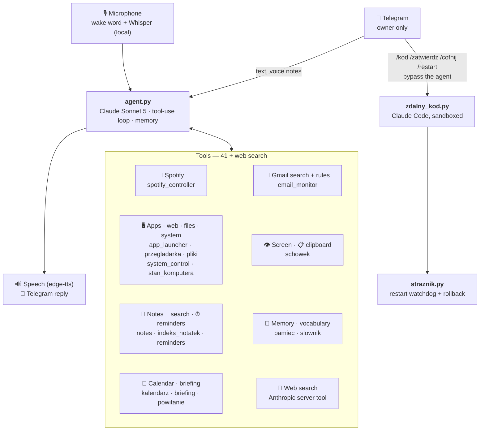

# 🤖 Jarvis — a personal voice assistant for Windows

An Iron Man–style assistant you talk to in Polish. Say **"Hey Jarvis"** and speak naturally: a Claude agent decides which tools to use, answers out loud and keeps the conversation going. Wake-word detection and speech recognition run locally; you can also reach Jarvis from your phone via Telegram.

## ✨ Key features

- 🎙️ **Conversation with interruptions** — "Hey Jarvis" once, then keep talking. Cut in mid-answer and it stops mid-word; "mów dalej" (go on) resumes exactly where it was cut off. In headphones mode any word interrupts it
- 🧠 **Agent with tools** — one Claude tool-use loop (`agent.py`) with 41 tools plus web search; it sees tool results and retries on errors. Long-term memory, saved only when you ask
- 🎵 **Spotify** — songs, albums, pause, next, "what's playing", shuffle, repeat
- 📝 **Notes with semantic search** — voice notes saved as dated Markdown files; "co zanotowałem o…" searches all of them and your Obsidian vault by meaning (local embeddings, RAG) and answers with the date or note name
- ⏰ **Reminders and timers** — "in 20 minutes", "tomorrow at eight"; spoken and sent to Telegram, survive restarts
- 📅 **Google Calendar** (read-only) — "what do I have tomorrow?", recurring events, morning briefing, "welcome back" summary
- 📧 **Gmail with rules** (read-only, up to 3 accounts) — search mail and set watch rules ("tell me when a mail from Allegro arrives"); misheard account names are matched fuzzily
- 🖥️ **System control** — apps from the Start menu, websites in Opera GX, volume, brightness, lock, sleep, restart/shutdown (after confirmation), PC status, reading the screen, clipboard translate/summarise
- 📁 **Files** — folders and text/Markdown files on request ("zrób na pulpicie notatkę zakupy…"), listing, opening in Explorer, appending, editing with a preview, moving and copying ("wrzuć wszystkie PDF-y do folderu Faktury"). Only in allowed folders, never deleting; overwrites, edits and moving more than 5 files wait for your "tak"
- 📱 **Telegram** — chat by text or voice note from your phone; reminders, mail alerts and screenshots come to you
- 🛠️ **Remote Claude Code tasks** — `/kod <task>` lets Claude Code (Opus 5.5) edit Jarvis's own source in a sandbox, then runs the tests; `/zatwierdz` commits, `/cofnij` undoes, `/restart` rolls back automatically if the new version fails to start
- 💫 **Iron Man HUD** — full-screen reactor reacting to state, live wallpaper mode, side panel on a second monitor

## 🧠 Architecture



Every utterance, spoken or from Telegram, goes to `agent.py`. It sends the text to Claude with the tool definitions, runs the tools Claude asks for and feeds their results back until the answer is ready. The answer is spoken sentence by sentence while the rest is still being generated. Reminders, mail rules and HUD readings run in background threads and never call the model. Telegram coding commands skip the agent entirely, so the model has no way to start Claude Code on its own.

## 📱 Telegram and remote coding

The bot answers only you (both chat and sender ID are checked). Chat and voice notes go to the agent; "stop" interrupts an answer, and a PC restart or shutdown needs a typed "tak". These commands go straight to Claude Code instead:

| Command | What it does |
|---|---|
| `/kod <task>` | Runs Claude Code in Jarvis's folder in the background, then the test suite; sends Claude's summary, the changed files and the test result |
| `/zatwierdz [message]` | Commits only the files changed by `/kod` tasks |
| `/cofnij` | Reverts uncommitted `/kod` changes; your own uncommitted work stays |
| `/restart` | Restarts Jarvis. If the tests fail, it warns you first and waits for a typed "tak"; if the new version isn't up within a minute, it returns to the last working version and tells you why |

Claude Code can only read and edit files in the project; from the shell it may run nothing but `git status` and `git diff`, enforced by a hook stored outside the project. It runs on your Claude subscription, not Jarvis's API key. Requires the source version, Git and the [Claude Code CLI](https://code.claude.com) logged in once.

## 📥 Installation

**Requirements:** Windows 10/11 (64-bit), a microphone, internet, ~1 GB of disk space and an Anthropic API key with credit (an ordinary sentence costs about 0.3–0.6 ¢).

**Installer:** download `JarvisSetup.exe` from [Releases](https://github.com/klosuj3bator/Jarvis-voice-assistant/releases) and run it (no admin rights). It isn't code-signed yet, so Windows may show **More info → Run anyway**.

**From source** (Python 3.14):

```bash
git clone https://github.com/klosuj3bator/Jarvis-voice-assistant.git
cd Jarvis-voice-assistant
python -m venv venv
venv\Scripts\activate
pip install -r requirements.txt
python main.py
```

`Jarvis.pyw` runs it in the background without a console.

### Setup wizard

On first launch a wizard walks you through the keys. Later you can reopen it as **Settings** from the tray icon. Each page explains where to get the key, and **"Sprawdź i dalej"** (check & continue) tests it against the service before moving on. Only Anthropic is required; skipped features stay off until you add them. The installed version also downloads the speech models here (~560 MB). The last pages set the wallpaper monitor and the side panel.

<p align="center"></p>

**Required**

| Key | Where to get it |
|---|---|
| `ANTHROPIC_API_KEY` | [platform.claude.com](https://platform.claude.com) → API Keys |

**Optional**

| Feature | Keys | Where to get them |
|---|---|---|
| Spotify (Premium) | `SPOTIPY_CLIENT_ID`, `SPOTIPY_CLIENT_SECRET` | [Spotify dashboard](https://developer.spotify.com/dashboard) → Create app, redirect URI `http://127.0.0.1:8888/callback` |
| Telegram | `TELEGRAM_JARVIS_TOKEN`, `TELEGRAM_OWNER_ID` | [@BotFather](https://t.me/BotFather) → `/newbot`; the wizard detects your ID |
| Gmail (1–3 accounts) | `GMAIL_n_ADDRESS`, `GMAIL_n_APP_PASSWORD`, optional `GMAIL_n_NAME`, `GMAIL_DOMYSLNE` | an [app password](https://myaccount.google.com/apppasswords) per account (needs 2-step verification) |
| Google Calendar | `GOOGLE_CALENDAR_ICAL_URL` | Calendar settings → Integrate calendar → secret address in iCal format |
| File tools | `JARVIS_DOZWOLONE_FOLDERY` | folders Jarvis may work in, separated by `;` (default: Desktop and Documents) |
| Obsidian vault search | `OBSIDIAN_VAULT_PATH` | path to your vault folder (in `.env`); voice notes are searched without it |

The notes-search model (multilingual-e5-small, ~135 MB) downloads in the background on first start; Jarvis works without it in the meantime.

Keys entered in the wizard are stored in `%APPDATA%\Jarvis\config.env`. The source version also reads a `.env` file (template: `.env.example`). Priority: Windows environment variables → Settings → `.env`.

## 🧪 Running tests

```bash
pip install -r requirements-dev.txt
python -m pytest
```

The suite in `tests/` (about 190 tests, ~20 s) covers:
- notes and the semantic notes index (with a mock embedding model, plus the real one if downloaded);
- reminders, including saving and reading them back after a restart;
- long-term memory;
- mail watch rules;
- conversation-history trimming and interruptions;
- file tools (allowed paths, confirmations, moving);
- the remote-coding commands.

**Isolation.** The tests never touch your real files, keys or network:
- data paths are redirected to a temporary folder;
- keys are removed from the environment;
- any connection outside your PC raises an error.

Claude, Spotify, Gmail and Telegram are replaced by mocks (`tests/atrapy.py`), so no tokens are used and nothing is sent.

After every `/kod` task Jarvis runs the suite and adds the result to the Telegram summary. If the tests fail, `/restart` warns you and waits for a typed "tak".

## 🔒 Security

- **Keys stay out of the repository.** They live in `%APPDATA%\Jarvis` or in a git-ignored `.env`, and never reach the log. The installer build and `/zatwierdz` both refuse to continue if a key value turns up in the files.
- **The Telegram bot answers only its owner.** Messages from anyone else are ignored without a reply. Messages sent while Jarvis was off are skipped, not executed later.
- **Mail is treated as data, never as instructions.** Once mail has been read, tools are locked in code until the end of that answer, so a stranger's email can't make Jarvis do anything. Gmail and the calendar are read-only.
- **File tools stay in bounds.** They work only in the allowed folders: no `..`, nothing outside them, and never Jarvis's own folder. There is no delete tool. Overwriting, editing and moving more than 5 files need your "tak" in your *next* sentence; the model can't confirm on its own. The model never reads file contents, apart from the lines an edit changes, and refuses files that hold keys or passwords.
- **Audio and notes stay local.** Microphone audio never leaves the PC; only the recognised text goes to Claude. Notes are embedded by a local model and indexed in a git-ignored `indeks_notatek/` folder; Claude sees only the few fragments found for your question.

## 📂 Project structure

| File | Purpose |
|---|---|
| `main.py`, `Jarvis.pyw` | startup, listening and conversation loop |
| `agent.py` | the Claude agent: instructions, tools, history, costs |
| `wake_word_listener.py`, `tts.py` | wake word, recording, Whisper, interruptions; speech output |
| `telegram_bridge.py` | Telegram chat and commands |
| `zdalny_kod.py`, `straznik.py` | remote Claude Code tasks; restart watchdog and rollback |
| `spotify_controller.py`, `app_launcher.py`, `przegladarka.py`, `system_control.py` | music, apps, browser, PC control |
| `notes.py`, `reminders.py`, `kalendarz.py`, `email_monitor.py`, `briefing.py`, `powitanie.py` | notes, reminders, calendar, mail, briefing, greeting |
| `indeks_notatek.py` | semantic notes search (`search_notes`): local multilingual-e5-small embeddings, SQLite vector index, updates only changed files |
| `pamiec.py`, `slownik.py`, `schowek.py`, `stan_komputera.py` | memory, vocabulary, clipboard, PC status |
| `pliki.py`, `potwierdzenia.py` | file tools with allowed folders and confirmations; shared "tak" detection |
| `gui.py`, `hud.qml`, `Panel.qml`, `tapeta.py`, `panel.py`, `pasek_boczny.py` | HUD, wallpaper mode, side panel |
| `setup_wizard.py`, `konfiguracja.py`, `rozruch.py` | wizard and Settings, key loading, parallel startup |
| `tests/`, `pytest.ini` | automated tests with mocked services (`python -m pytest`) |
| `instalator/` | installer build: PyInstaller, Inno Setup, privacy check (`python instalator/zbuduj.py`) |

## ⚠️ Known limitations

- **Windows only.** Speech recognition runs on the CPU, so expect a few seconds' delay.
- **Interruptions** work best with headphones; use headphones mode only with headphones.
- **Wallpaper mode** is tested on Windows 10; on Windows 11 24H2 it may fall back to a normal bottom-most window.
- **Remote coding** works only in the source version. Claude Code itself can't run commands there, so it can't run the tests; Jarvis runs them after each task.

## 👤 Author

Maciek — [GitHub](https://github.com/klosuj3bator)
