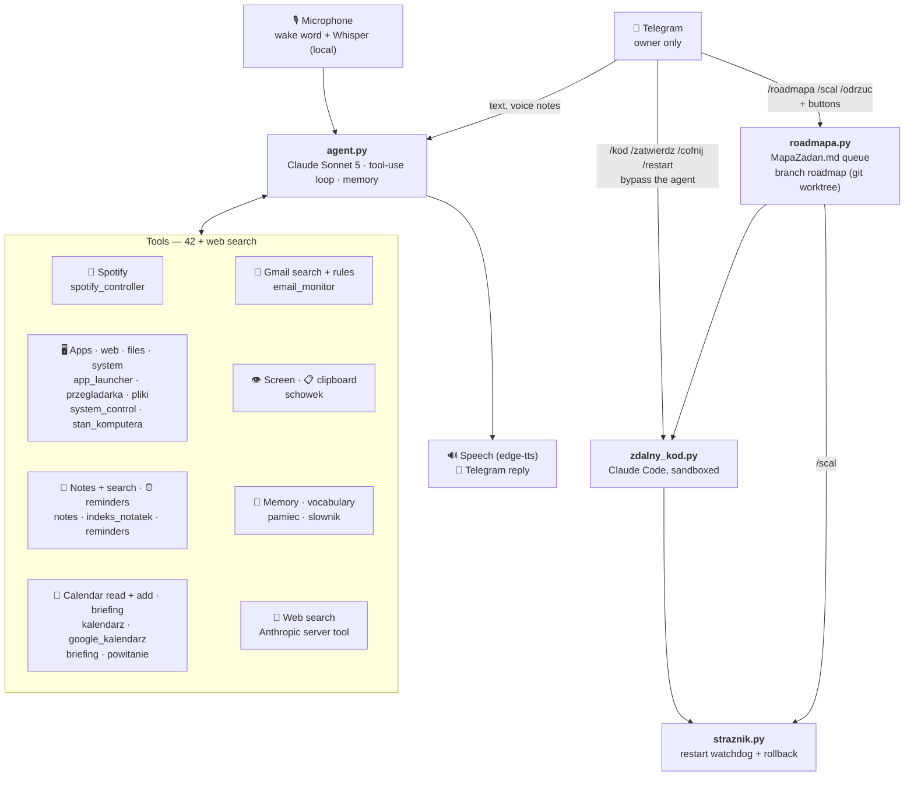
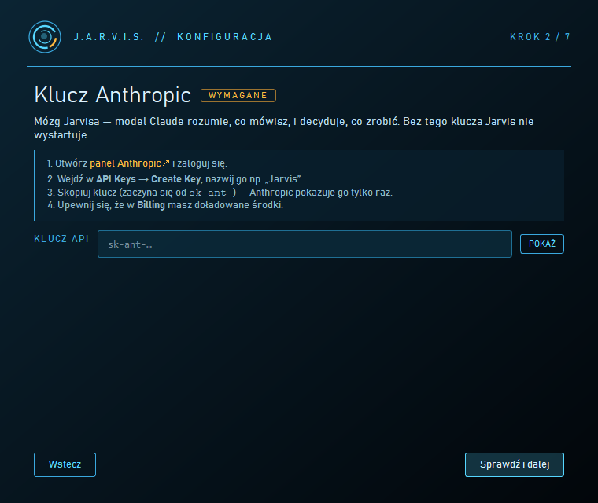

# 🤖 Jarvis — a personal voice assistant for Windows

[](https://github.com/klosuj3bator/Jarvis-voice-assistant/actions/workflows/testy.yml)

An Iron Man–style assistant you talk to in Polish. Say **"Hey Jarvis"** and speak naturally: a Claude agent decides which tools to use, answers out loud and keeps the conversation going. Wake-word detection and speech recognition run locally; you can also reach Jarvis from your phone via Telegram.

## ✨ Key features

- 🎙️ **Conversation with interruptions** — "Hey Jarvis" once, then keep talking. Cut in mid-answer and it stops mid-word; "mów dalej" (go on) resumes exactly where it was cut off. In headphones mode any word interrupts it
- 👋 **Greeting after startup** — for the first 10 minutes after Jarvis starts, "hej, wróciłem", "cześć Jarvis" or "jestem" is enough, no "Hey Jarvis". It greets you with the latest news (new important mail, today's reminders, the next event), then switches to the usual wake-word mode. Everything else said in that window is ignored and not logged
- 🗣️ **Custom wake word** — drop your own openWakeWord model at `models/jarvis.onnx` and Jarvis listens for it instead of the built-in "Hey Jarvis"; the sensitivity threshold is set in Settings
- 🧠 **Agent with tools** — one Claude tool-use loop (`agent.py`) with 42 tools plus web search; it sees tool results and retries on errors. Long-term memory, saved only when you ask
- 🎵 **Spotify** — songs, albums, pause, next, "what's playing", shuffle, repeat
- 📝 **Notes with semantic search** — voice notes saved as dated Markdown files; "co zanotowałem o…" searches them, the text files Jarvis created (e.g. a shopping list on the Desktop) and your Obsidian vault by meaning (local embeddings, RAG), and answers with the note's name and date
- ⏰ **Reminders and timers** — "in 20 minutes", "tomorrow at eight"; spoken and sent to Telegram, survive restarts
- 📅 **Google Calendar** — "what do I have tomorrow?", adding events ("dodaj rozmowę rekrutacyjną w piątek o 10") after your "tak", a spoken + Telegram reminder 30 minutes before each event, morning briefing, "welcome back" summary. Google Calendar API with the iCal address as a read-only fallback; never deletes events
- 📧 **Gmail with rules** (read-only, up to 3 accounts) — search mail and set watch rules ("tell me when a mail from Allegro arrives"); misheard account names are matched fuzzily
- 🖥️ **System control** — apps from the Start menu, websites in Opera GX, volume, brightness, lock, sleep, restart/shutdown (after confirmation), PC status, reading the screen, clipboard translate/summarise
- 📁 **Files** — folders and text/Markdown files on request ("zrób na pulpicie notatkę zakupy…"), listing, opening in Explorer, appending, editing with a preview, moving and copying ("wrzuć wszystkie PDF-y do folderu Faktury"). Only in allowed folders, never deleting; overwrites, edits and moving more than 5 files wait for your "tak"
- 📱 **Telegram** — chat by text or voice note from your phone; reminders, mail alerts and screenshots come to you
- 🛠️ **Remote Claude Code tasks** — `/kod <task>` lets Claude Code (Opus 5.5 by default, model set in Settings) edit Jarvis's own source in a sandbox, then runs the tests; `/zatwierdz` commits, `/cofnij` undoes, `/restart` rolls back automatically if the new version fails to start
- 🗺️ **Roadmap mode** — Jarvis takes the numbered tasks from `MapaZadan.md` in order and proposes the next one on Telegram (number, difficulty [Ł]/[Ś]/[T], task, model) with **Accept / Skip / Show others** buttons; Part B tasks first ask what Jarvis needs from you. Accepted tasks run in Claude Code on a separate `roadmap` branch, get committed and tested, and the next proposal follows, always waiting for your click. Pauses when Claude Code runs out of usage and asks before continuing; daily report at noon; `/scal` merges into `main`
- 💫 **Iron Man HUD** — full-screen reactor reacting to state, live wallpaper mode, side panel on a second monitor

## 🧠 Architecture



Every utterance, spoken or from Telegram, goes to `agent.py`. It sends the text to Claude with the tool definitions, runs the tools Claude asks for and feeds their results back until the answer is ready. The answer is spoken sentence by sentence while the rest is still being generated. Reminders, calendar reminders, mail rules and HUD readings run in background threads and never call the model. Telegram coding commands skip the agent entirely, so the model has no way to start Claude Code on its own.

## 📱 Telegram and remote coding

The bot answers only you (both chat and sender ID are checked). Chat and voice notes go to the agent; "stop" interrupts an answer, and a PC restart or shutdown needs a typed "tak". These commands go straight to Claude Code instead:

| Command | What it does |
|---|---|
| `/kod <task>` | Runs Claude Code in Jarvis's folder in the background, then the test suite; sends Claude's summary, the changed files and the test result |
| `/zatwierdz [message]` | Commits only the files changed by `/kod` tasks |
| `/cofnij` | Reverts uncommitted `/kod` changes; your own uncommitted work stays |
| `/restart` | Restarts Jarvis. If the tests fail, it warns you first and waits for a typed "tak"; if the new version isn't up within a minute, it returns to the last working version and tells you why |
| `/roadmapa [status\|dalej]` | Roadmap mode status (current task, queue, what's waiting to be merged, last test result) / the next step |
| `/scal` | Merges the `roadmap` branch into `main` and restarts with the same watchdog and rollback as `/restart`; asks first if the tests don't pass |
| `/odrzuc` | Discards everything on `roadmap` that isn't in `main` (after a confirmation button; a copy is kept under `refs/jarvis/`); the tasks return to the queue |

Claude Code can only read and edit files in the project; from the shell it may run nothing but `git status` and `git diff`, enforced by a hook stored outside the project. It runs on your Claude subscription, not Jarvis's API key. Requires the source version, Git and the [Claude Code CLI](https://code.claude.com) logged in (if the login expires, Jarvis tells you to run `claude` → `/login`). Only one Claude Code task runs at a time, `/kod` or roadmap.

### Roadmap mode

Turn it on in Settings → **Ogólne**. Tasks live in `MapaZadan.md` (or `MapaZadan.txt`). A task is a single **numbered line**: the number, the difficulty in square brackets and the text. A number in parentheses at the end points to an idea in `POMYSLY_JARVIS.md`. Headings (`##`, `###`) only group tasks and are never tasks; a heading with `CZĘŚĆ B` starts the tasks that need you.

```markdown
## CZĘŚĆ A — zadania do wykonania samodzielnie przez Claude Code
### Etap 3. Rozmowa i głos
15. [Ł] Dźwięk potwierdzenia ("bip") po wykryciu słowa aktywującego. (5)

## CZĘŚĆ B — zadania wymagające mojego udziału
86. [Ś] Statystyki gier (League of Legends) — wymagany klucz Riot API. (67)
```

Difficulty picks the model: **[Ł]** easy and **[Ś]** medium → the "easy" model (Sonnet 5.5 by default), **[T]** hard → the "hard" model (Opus 5.5 by default). With no difficulty, Jarvis doesn't guess. It asks you to pick the model in the proposal.

- **Proposals** come in file order and are short: *"Zadanie 1 ze 100 · nr 15 [Ł]"*, the task text and the model. The counter counts only unfinished tasks. Buttons: **Akceptuj / Pomiń / Pokaż inne / Zmień model**. **Pomiń** moves the task to the end of the queue.
- **Part B tasks never start on their own.** They're marked *"wymaga Twojego udziału"*. When one comes up, Jarvis first writes on Telegram what it needs from you, found by a read-only Claude Code pass over the code (Read/Glob/Grep, no edits). Then it waits. You answer by replying to that message, as many times as you like. Anything that looks like a password or key is refused, since keys go into Settings. The task starts only when you press **Zaczynaj**, with your answers included in the task.
- **Before a task starts**, there must be no uncommitted changes and the tests on `roadmap` must pass. Only one Claude Code task runs at a time.
- **Each task** runs in a separate git worktree of the `roadmap` branch (`%APPDATA%\Jarvis\roadmapa`), so the folder Jarvis runs from stays on `main`. Jarvis then runs the tests, marks the task as done in `MapaZadan.md` (`15. ✅ [Ł] …`), commits, and sends the summary, the changed files and the test result, followed by the next proposal. If the tests fail, it offers **Napraw testy** instead.
- **Usage limits.** When Claude Code runs out of usage, Jarvis stops, keeps the unfinished changes, and messages you straight away. It reads the reset time from the message (otherwise it checks every 30 minutes) and asks *"Limity wróciły — kontynuujemy?"* before resuming the same Claude Code conversation.
- **Daily report** at 12:00 (time set in Settings): what was done, the test result, what's next in the queue.
- **Nothing reaches `main` without `/scal`**, and Jarvis never restarts itself — only `/scal` restarts it.

## 📥 Installation

**Requirements:** Windows 10/11 (64-bit), a microphone, internet, ~1 GB of disk space and an Anthropic API key with credit (an ordinary sentence costs about 0.3–0.6 ¢).

**Installer:** download `JarvisSetup.exe` from [Releases](https://github.com/klosuj3bator/Jarvis-voice-assistant/releases) and run it (no admin rights). It isn't code-signed yet, so Windows may show **More info → Run anyway**.

**From source** (Python 3.14):

```bash
git clone https://github.com/klosuj3bator/Jarvis-voice-assistant.git
cd Jarvis-voice-assistant
python -m venv venv
venv\Scripts\activate
pip install -r requirements.txt
python main.py
```

`Jarvis.pyw` runs it in the background without a console.

### Setup wizard and Settings

Jarvis never opens a wizard or key windows at startup (the installed version only shows a download bar for the speech models, ~560 MB, on first launch). If a key is missing, a small **"KLUCZE API: BRAK 2"** line (the number is how many are missing) shows on the right of the HUD. It is red when the Anthropic key is missing; then Jarvis replies only that a conversation needs the key and where to add it. Click the line, or **Klucze API** in the tray menu, and **Settings** opens on the **Klucze API** tab. The line disappears once every key is set, or once you deliberately turn a feature off.

Settings has tabs (Klucze API, Ogólne, Tapeta, Panel boczny, Nasłuch, Podsumowanie); **Ogólne** holds the roadmap mode and the Claude Code models for hard and easy tasks (Opus 5.5, Opus 5, Sonnet 5.5, Sonnet 5, Haiku 5.5). Each key page explains where to get the key, and **"Sprawdź i dalej"** (check & continue) tests it against the service before saving. Only Anthropic is required; the other features stay off until you add them.

<p align="center"></p>

**Required**

| Key | Where to get it |
|---|---|
| `ANTHROPIC_API_KEY` | [platform.claude.com](https://platform.claude.com) → API Keys |

**Optional**

| Feature | Keys | Where to get them |
|---|---|---|
| Spotify (Premium) | `SPOTIPY_CLIENT_ID`, `SPOTIPY_CLIENT_SECRET` | [Spotify dashboard](https://developer.spotify.com/dashboard) → Create app, redirect URI `http://127.0.0.1:8888/callback` |
| Telegram | `TELEGRAM_JARVIS_TOKEN`, `TELEGRAM_OWNER_ID` | [@BotFather](https://t.me/BotFather) → `/newbot`; the wizard detects your ID |
| Gmail (1–3 accounts) | `GMAIL_n_ADDRESS`, `GMAIL_n_APP_PASSWORD`, optional `GMAIL_n_NAME`, `GMAIL_DOMYSLNE` | an [app password](https://myaccount.google.com/apppasswords) per account (needs 2-step verification) |
| Google Calendar (API) | `google_credentials.json`, then **Połącz z Google** | [Google Cloud](https://console.cloud.google.com) → enable the Calendar API; on the OAuth consent screen add yourself as a test user; create an OAuth client ID of type *Desktop app*, download the JSON and save it as `google_credentials.json` in Jarvis's data folder (the project folder, or `%APPDATA%\Jarvis` when installed). Then Settings → Klucze API → Kalendarz Google → **Połącz z Google** and sign in in the browser; the token is saved in `google_token.json` |
| Calendar fallback (read-only) | `GOOGLE_CALENDAR_ICAL_URL` | Calendar settings → Integrate calendar → secret address in iCal format; used when the API is not connected or not responding |
| Calendar reminders | `JARVIS_PRZYPOMNIENIE_KALENDARZA_MIN` | minutes before an event (default 30, `0` turns them off) |
| File tools | `JARVIS_DOZWOLONE_FOLDERY` | folders Jarvis may work in, separated by `;` (default: Desktop and Documents) |
| Obsidian vault search | `OBSIDIAN_VAULT_PATH` | path to your vault folder (in `.env`); voice notes are searched without it |

The notes-search model (multilingual-e5-small, ~135 MB) downloads in the background on first start; Jarvis works without it in the meantime.

### Listening (Settings → Nasłuch)

| Setting | Variable | Default |
|---|---|---|
| Greeting after startup on/off | `JARVIS_POWITANIE_PO_STARCIE` | on (`0` turns it off) |
| How long Jarvis waits for the greeting | `JARVIS_OKNO_POWITANIA_MIN` | 10 minutes (1–60) |
| Wake-word sensitivity threshold | `JARVIS_PROG_WAKE_WORDA` | automatic: 0.2 for "Hey Jarvis", 0.5 for a custom model; lower = easier to wake, but more false starts |

A greeting is recognised locally, from the words alone: a short phrase made only of greeting words. "Jestem", "wróciłem" or "z powrotem" work on their own; plain hellos ("cześć", "dzień dobry") need the name ("cześć Jarvis"), so a phone call or greeting someone else doesn't trigger it. "Hej Jarvis, puść muzykę" said in the window is treated as a normal command.

**Custom wake word:** save a trained openWakeWord model as `models/jarvis.onnx` in the project folder (`%APPDATA%\Jarvis\models\jarvis.onnx` when installed) and restart Jarvis. If the file is missing or won't load, Jarvis falls back to "Hey Jarvis". `python wake_word_listener.py kalibracja` shows how your pronunciation scores against the current threshold. The `models/` folder is git-ignored and never packed into the installer.

Keys entered in the wizard are stored in `%APPDATA%\Jarvis\config.env`. The source version also reads a `.env` file (template: `.env.example`). Priority: Windows environment variables → Settings → `.env`.

## 🧪 Running tests

```bash
pip install -r requirements-test.txt
python -m pytest
```

`requirements-test.txt` is a lightweight list: only what the tests import, without Whisper, openWakeWord, the embedding model or Qt (about a minute to install in a fresh environment). `sounddevice` is included only so the listening module can be imported; the tests never open a microphone. If you already installed `requirements.txt`, you only need `pytest` from `requirements-dev.txt`.

**GitHub Actions** ([`.github/workflows/testy.yml`](.github/workflows/testy.yml)) runs the same suite on Windows for every push and pull request. No keys or secrets are needed: every external service is mocked. The badge at the top shows the result.

The suite in `tests/` (about 330 tests, ~1 min) covers:
- notes and the semantic notes index (with a mock embedding model, plus the real one if downloaded);
- reminders, including saving and reading them back after a restart;
- long-term memory;
- mail watch rules;
- conversation-history trimming and interruptions;
- file tools (allowed paths, confirmations, moving);
- Google Calendar: OAuth login with PKCE against a local fake browser, token refresh and expiry, reading and adding events in Europe/Warsaw time, the iCal fallback and event reminders;
- missing API keys: the HUD counter, the reply without an Anthropic key, Settings opening on the Klucze API tab;
- the greeting window after startup: what counts as a greeting, the time limit, one answer and back to wake-word mode, the Nasłuch tab;
- the wake word: custom `models/jarvis.onnx` with a fallback to "Hey Jarvis", the threshold from Settings, quiet listening that logs nothing;
- the remote-coding commands;
- roadmap mode on a throwaway git repository: parsing `MapaZadan.md` (exactly 100 tasks with the right difficulties, on a frozen copy in `tests/dane/`), the queue and skipping, model choice, a task committed on `roadmap` while `main` stays untouched, pre-start checks, usage limits (reading the reset time, waiting for your consent), `/scal` with a restart, `/odrzuc`, the daily report, Telegram buttons.

**Isolation.** The tests never touch your real files, keys or network:
- data paths are redirected to a temporary folder;
- keys are removed from the environment;
- any connection outside your PC raises an error.

Claude, Spotify, Gmail, Google Calendar and Telegram are replaced by mocks (`tests/atrapy.py`), so no tokens are used and nothing is sent.

After every `/kod` task Jarvis runs the suite and adds the result to the Telegram summary. If the tests fail, `/restart` warns you and waits for a typed "tak".

## 🔒 Security

- **Keys stay out of the repository.** They live in `%APPDATA%\Jarvis` or in a git-ignored `.env`, and never reach the log. The installer build and `/zatwierdz` both refuse to continue if a key value turns up in the files.
- **The Telegram bot answers only its owner.** Messages from anyone else are ignored without a reply. Messages sent while Jarvis was off are skipped, not executed later.
- **Mail is treated as data, never as instructions.** Once mail has been read, tools are locked in code until the end of that answer, so a stranger's email can't make Jarvis do anything. Gmail is read-only.
- **Roadmap work stays off `main`.** Claude Code works in a separate worktree of the `roadmap` branch with the same limits as `/kod` and can't edit `MapaZadan.md`. Every task starts only after your button press; `main` changes only with `/scal`, and only `/scal` restarts Jarvis, under the watchdog. Buttons are accepted only from you, and clicks queued while Jarvis was off are ignored.
- **File tools stay in bounds.** They work only in the allowed folders: no `..`, nothing outside them, and never Jarvis's own folder. There is no delete tool. Overwriting, editing and moving more than 5 files need your "tak" in your *next* sentence; the model can't confirm on its own. The model never reads file contents, apart from the lines an edit changes, and refuses files that hold keys or passwords.
- **Calendar access is narrow.** Google sign-in starts only when you click **Połącz z Google**: a local `127.0.0.1` redirect with PKCE, scope limited to calendar events. Jarvis can read and add events, never delete them, and every new event is read back to you and waits for your "tak". `google_credentials.json` and `google_token.json` are git-ignored and never packed into the installer. If Google revokes access, Jarvis tells you out loud and on Telegram, and falls back to the iCal address.
- **Audio and notes stay local.** Microphone audio never leaves the PC; only the recognised text goes to Claude. In the greeting window after startup, speech is recognised locally and only a greeting or a "Jarvis, …" command reaches Claude; anything else is dropped without writing its text to the log or saving the recording. Notes are embedded by a local model and indexed in a git-ignored `indeks_notatek/` folder; Claude sees only the few fragments found for your question.

## 📂 Project structure

| File | Purpose |
|---|---|
| `main.py`, `Jarvis.pyw` | startup, listening and conversation loop |
| `agent.py` | the Claude agent: instructions, tools, history, costs |
| `wake_word_listener.py`, `tts.py` | wake word, recording, Whisper, interruptions; speech output |
| `slowo_aktywujace.py`, `powitanie_startowe.py` | which wake-word model and threshold (custom `models/jarvis.onnx` or "Hey Jarvis"); the greeting window after startup |
| `telegram_bridge.py` | Telegram chat and commands |
| `zdalny_kod.py`, `straznik.py` | remote Claude Code tasks; restart watchdog and rollback |
| `roadmapa.py`, `MapaZadan.md` | roadmap mode: task queue, proposals with buttons, `roadmap` branch worktree, usage limits, `/scal`, `/odrzuc`, daily report |
| `spotify_controller.py`, `app_launcher.py`, `przegladarka.py`, `system_control.py` | music, apps, browser, PC control |
| `notes.py`, `reminders.py`, `kalendarz.py`, `email_monitor.py`, `briefing.py`, `powitanie.py` | notes, reminders, calendar (API with iCal fallback, adding events, event reminders), mail, briefing, greeting |
| `google_kalendarz.py` | Google Calendar API: OAuth sign-in (loopback + PKCE), token refresh, reading and adding events |
| `indeks_notatek.py` | semantic notes search (`search_notes`) over voice notes, files created by Jarvis and the Obsidian vault: local multilingual-e5-small embeddings, SQLite vector index, updates only changed files |
| `pamiec.py`, `slownik.py`, `schowek.py`, `stan_komputera.py` | memory, vocabulary, clipboard, PC status |
| `pliki.py`, `potwierdzenia.py` | file tools with allowed folders; shared confirmations ("tak" in your next sentence) for files and calendar events |
| `gui.py`, `hud.qml`, `Panel.qml`, `tapeta.py`, `panel.py`, `pasek_boczny.py` | HUD, wallpaper mode, side panel |
| `setup_wizard.py`, `konfiguracja.py`, `rozruch.py` | wizard and Settings (tabs, Google sign-in), key loading and the missing-keys count, parallel startup |
| `tests/`, `pytest.ini`, `requirements-test.txt` | automated tests with mocked services (`python -m pytest`), lightweight test dependencies |
| `.github/workflows/testy.yml` | GitHub Actions: the test suite on Windows for every push and pull request |
| `instalator/` | installer build: PyInstaller, Inno Setup, privacy check (`python instalator/zbuduj.py`) |

## ⚠️ Known limitations

- **Windows only.** Speech recognition runs on the CPU, so expect a few seconds' delay.
- **Greeting window** transcribes every utterance it hears for up to 10 minutes after startup. That costs CPU when a TV or conversation is running nearby; shorten the window or turn it off in Settings → Nasłuch.
- **Interruptions** work best with headphones; use headphones mode only with headphones.
- **Wallpaper mode** is tested on Windows 10; on Windows 11 24H2 it may fall back to a normal bottom-most window.
- **Remote coding** works only in the source version. Claude Code itself can't run commands there, so it can't run the tests; Jarvis runs them after each task.

## 👤 Author

Maciek — [GitHub](https://github.com/klosuj3bator)
